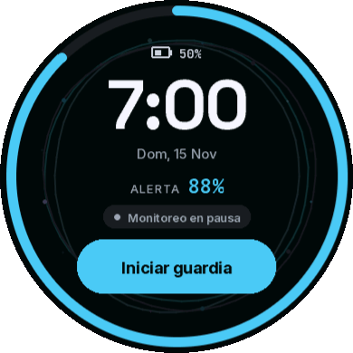
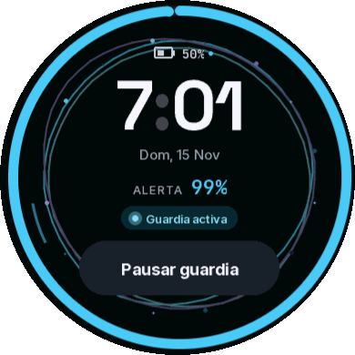
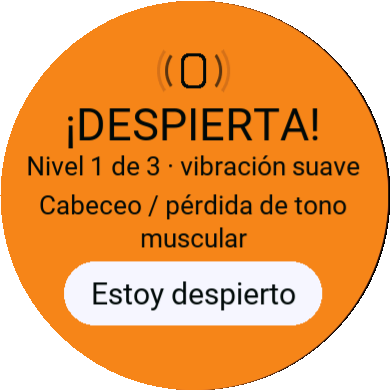
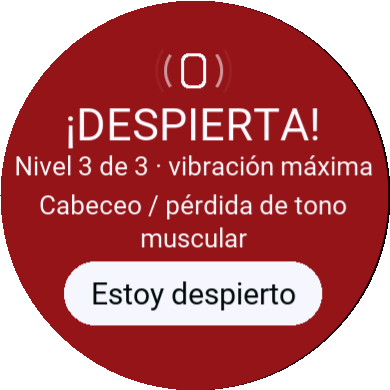
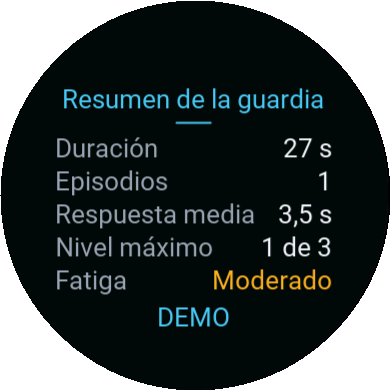

# FocusPulse AI

Aplicación nativa de **Garmin Connect IQ** (Monkey C, `watch-app`) para el **Forerunner 165**
y el **Forerunner 165 Music** (pantalla redonda AMOLED de 390×390, táctil y botones).

FocusPulse AI detecta **micro-sueños** —cabeceos e inactividad prolongada— con el
acelerómetro del reloj y despierta al usuario con **vibraciones progresivas**. Un modelo de
IA entrenado (regresión logística) confirma cada cabeceo antes de alertar. Incluye un
**modo demo** con datos simulados y un guion automático para presentarla sin dormirse.

**Versión 1.0.0.** Lista para subir a la Connect IQ Store ([docs/STORE.md](docs/STORE.md)).

> **No es un dispositivo médico.** No diagnostica ni trata trastornos del sueño, no
> garantiza detectar todos los episodios y **no sustituye el descanso**. No la uses para
> mantenerte despierto al conducir.

| Esfera | Guardia activa | Alerta nivel 1 | Alerta nivel 3 | Resumen |
|---|---|---|---|---|
|  |  |  |  |  |

Más capturas, en español e inglés: [docs/STORE.md §7](docs/STORE.md#7-galería).

## Qué hace

- **Guardia** (START o un toque en el botón): lee el acelerómetro a 25 Hz. La esfera muestra
  el **nivel de alerta** (anillo y porcentaje), la hora, la batería y un **orbe IA** que
  cambia de color y de ritmo según el estado.
- **Detector por reglas** ([docs/DETECTOR.md](docs/DETECTOR.md)): cabeceo = sacudida
  > 400 mg + quietud antes de 5 s + cambio de inclinación > 35°; inactividad = 60 s inmóvil.
- **Clasificador v2** ([docs/IA.md](docs/IA.md)): Activo / Normal / Cabeceo / Inerte,
  entrenado en Python con datos sintéticos y exportado a Monkey C. Mueve el puntaje y el orbe
  y **confirma los cabeceos** 2 s después (descarta mirar la hora).
- **Alerta** a pantalla completa "¡DESPIERTA!": vibración por pulsos, luz y tono; sin
  respuesta sube del nivel 1 al 3. Solo se cierra con "Estoy despierto" (BACK no). Si llega
  con un menú abierto, lo cierra y se abre sobre la esfera.
- **Fatiga y descanso**: tras varios episodios recomienda un descanso guiado de 15 min.
- **Resumen e historial**: al pausar, resumen de la guardia; se guardan las 10 últimas.
  *Historial > Borrar historial* pide confirmación.
- **Sin datos del sensor**: si en 5 s no llegan lotes, aviso ámbar en la esfera; un corte
  nunca cuenta como inactividad.
- **AMOLED**: fondo casi negro, contraste ≥ 4,5:1 y la esfera se desplaza ±2 px cada
  minuto contra el quemado.

## Requisitos

| Herramienta | Detalle |
|---|---|
| **JDK** | Java 17 o superior en el `PATH`. |
| **Connect IQ SDK Manager** | De developer.garmin.com/connect-iq/sdk. Instala un SDK (márcalo como actual) y los dispositivos `fr165` y `fr165m`. Probado con el **SDK 9.3.0**. |
| **VS Code + Monkey C** | Opcional (extensión `garmin.monkey-c`, la instala `setup.ps1`). |
| **Llave de desarrollador** | `developer_key.der` en `%USERPROFILE%\Downloads\FocusPulse-keys\` (la genera `setup.ps1`). **Nunca se versiona**; haz copia de seguridad: sin ella no se pueden publicar actualizaciones. |
| **Python 3.12** | Solo para entrenar el modelo (`scripts\train.ps1`). |

## Compilar, ejecutar, probar y entrenar

Desde la raíz del repo, en PowerShell (si la política de ejecución los bloquea:
`powershell -ExecutionPolicy Bypass -File scripts\<script>.ps1`).

```powershell
.\scripts\setup.ps1              # una vez: extensión y llave
.\scripts\build.ps1              # compila (depuración) → bin\FocusPulse.prg
.\scripts\build.ps1 -Release     # compila como la tienda → bin\FocusPulse-release.prg
.\scripts\run.ps1 -Release       # abre el simulador del fr165 con la app (la de la demo)
.\scripts\run.ps1 -TargetDevice fr165m
.\scripts\test.ps1               # 205 pruebas unitarias en el simulador
.\scripts\export.ps1             # paquete firmado para la tienda → bin\FocusPulse.iq
.\scripts\train.ps1              # dataset sintético, entrenamiento, informe y pesos
```

| Script | Qué hace |
|---|---|
| `build.ps1` | Compila para `fr165` con verificación de tipos estricta (`-l 3`) y sin advertencias. `-Release` quita el código `(:debug)` (menú de depuración, trazas, auxiliares de pruebas). |
| `run.ps1` | Compila, abre el simulador y carga la app. `-NoBuild`, `-Release`, `-TargetDevice fr165m`. Copia la definición de los ajustes al simulador para su editor. |
| `test.ps1` | Compila con `-t`, ejecuta las pruebas (`(:test)` en `tests/`) y falla si alguna falla. Deja el simulador sin reloj: después, `run.ps1` otra vez. |
| `export.ps1` | Release para todos los productos del manifest (fr165 y fr165m), firmado. |
| `train.ps1` | Crea `ml\.venv`, genera los datos, entrena, evalúa v1/v2, elige el umbral de la confirmación y exporta `source\core\ClassifierWeights.mc`. Reproducible con la misma semilla (`-Seed`, `-NoExport`). Ver [ml/README.md](ml/README.md). |
| `icon.ps1` | Genera el ícono del launcher (54×54) con los colores de `Palette.mc`. |

**Modo demo.** Mantener UP en la esfera abre el menú principal → *Modo demo*. Con la
guardia activa, **DOWN** cambia de escenario (normal, tecleo, cabeceo, inactividad, mirar la
hora) y *Guion automático* lo recorre todo solo en ≈ 75 s. Paso a paso:
[docs/GUIA_DEMO.md](docs/GUIA_DEMO.md).

**Depuración.** La compilación de depuración (`build.ps1` / `run.ps1` sin `-Release`) añade
al menú principal *Depuración*: telemetría en vivo, detector en vivo, selector de fuente
(incluido un escenario manual) y la guía de estilo, y escribe trazas en la consola
(`EVENTO`, `ALERTA`, `SENSOR`, `FPS`…).

## Ajustes

En el reloj (**mantener UP → *Ajustes***) y en la app **Garmin Connect**; se aplican sin
reiniciar la guardia.

| Ajuste | Valores (por defecto en negrita) | Qué hace |
|---|---|---|
| Sensibilidad | Baja · **Media** · Alta | Sacudida 440 / 400 / 340 mg, inclinación 45 / 35 / 28°, inactividad 90 / 60 / 45 s (demo 12 / 8 / 6 s). |
| Vibración | Apagada · Suave · **Normal** · Fuerte | Número y duración de los pulsos (el FR165 no cambia la fuerza del motor). |
| Sonido | **Activado** · Desactivado | Tonos de la alerta (si el reloj tiene `playTone`). |
| Animaciones reducidas | Activado · **Desactivado** | Orbe sin partículas; alerta sin sacudida y con el pulso más lento. |
| Confirmación por IA | **Activado** · Desactivado | El modelo confirma cada cabeceo antes de la alerta. |
| Grabar actividad | **Activado** · Desactivado | Graba la guardia como actividad: el sistema mantiene sensor y vibración con la app en segundo plano. |

Sin vibración ni sonido la app avisa **"Alerta solo visual"**.

## Estructura

```
manifest.xml        watch-app, fr165/fr165m, permisos Sensor y Fit, español e inglés
monkey.jungle       Compilación (source/ y tests/; recursos en resources/ y resources-spa/)
source/app/         Entrada (FocusPulseApp), GuardController, ajustes, Storage, versión
source/core/        Lógica pura y probada: telemetría, detector, clasificador, alertas,
                    fatiga, historial, modo demo, ajustes, watchdog del sensor
source/platform/    Hardware: acelerómetro real y simulado, vibración, grabación
source/views/       Vistas, menús y delegados (UI delgada)
source/util/        Sistema de diseño: paleta, tipografía, layout redondo, dibujo, anti quemado
resources/          Inglés (por defecto): textos, ícono, ajustes de Garmin Connect
resources-spa/      Español
tests/              Pruebas Toybox.Test (205)
ml/                 Entrenamiento en Python (no se empaqueta en el reloj)
scripts/            PowerShell: setup, build, run, test, export, train, icon
docs/               Arquitectura, detector, IA, diseño, demo, tienda, sustentación, pendientes
```

## Documentación

- [docs/ARQUITECTURA.md](docs/ARQUITECTURA.md) — módulos, flujo de datos y fases.
- [docs/DETECTOR.md](docs/DETECTOR.md) — detector, línea base, clasificador, confirmación y fatiga.
- [docs/IA.md](docs/IA.md) — pipeline, fuga de datos, métricas v1/v2 y limitaciones.
- [docs/DISENO.md](docs/DISENO.md) — sistema de diseño, accesibilidad y AMOLED.
- [docs/GUIA_DEMO.md](docs/GUIA_DEMO.md) — demo paso a paso.
- [docs/SUSTENTACION.md](docs/SUSTENTACION.md) — guion, checklist, preguntas y cifras.
- [docs/STORE.md](docs/STORE.md) — ficha de la tienda, permisos y publicación.
- [docs/PENDIENTES.md](docs/PENDIENTES.md) — lo confirmado y lo que requiere el reloj real.
- [CHANGELOG.md](CHANGELOG.md) — cambios por fase.

## Limitaciones

- **Datos sintéticos.** El clasificador se entrenó y se evaluó solo con datos generados a
  partir de los escenarios simulados: sus cifras (93,3 % de exactitud) comparan versiones,
  no son precisión en una muñeca real.
- **Sin pruebas en un reloj real** todavía: vibración, ejes del acelerómetro, pantalla
  apagada y batería se verificaron solo en el simulador o quedan pendientes
  ([docs/PENDIENTES.md](docs/PENDIENTES.md)).
- El detector ve el 61 % de los cabeceos sintéticos (los más lentos no superan 400 mg) y
  mirar la hora con el brazo casi inmóvil todavía engaña a veces (3 de 24).
- Solo acelerómetro: el FR165 no tiene giroscopio.
- Memoria pico en el simulador: 98,8 kB de 763,6 kB (fr165 y fr165m).

## Créditos

- Desarrollo: Cristian, con asistencia de Claude Code (Anthropic).
- Garmin Connect IQ SDK 9.3.0 y simulador del Forerunner 165.
- Entrenamiento: Python, NumPy, pandas, scikit-learn y Matplotlib.
- Fuentes del sistema del reloj (Roboto en el simulador).
