# Ficha para la Connect IQ Store

Material para publicar **FocusPulse AI 1.2.0** en la Connect IQ Store: textos en español e
inglés, permisos, capturas y los pasos de publicación. Lo que no se pudo comprobar desde
el repo (límites exactos de caracteres, categorías disponibles, tamaños de imagen que pide
el formulario) está marcado como **verificar en el formulario**.

## 1. Datos de la ficha

| Campo | Valor |
|---|---|
| Nombre | **FocusPulse AI** (igual en ambos idiomas; es `@Strings.AppName`) |
| Tipo | Aplicación (`watch-app`) |
| Versión | **1.2.0** (debe coincidir con `AppInfo.VERSION`; el manifest no lleva versión) |
| Dispositivos | Forerunner 165 (`fr165`) y Forerunner 165 Music (`fr165m`) |
| Idiomas de la app | Español e inglés (inglés por defecto) |
| Categoría sugerida | Salud / bienestar; si no existe, Utilidades (**verificar en el formulario**) |
| Precio | Gratuita |
| Paquete | `bin\FocusPulse.iq` (generado con `scripts\export.ps1`) |

**Palabras clave (es):** somnolencia, micro-sueño, cabeceo, alerta, vigilia, fatiga,
descanso, acelerómetro, vibración, estudio, concentración.

**Keywords (en):** drowsiness, microsleep, head nod, alert, wakefulness, fatigue, break,
accelerometer, vibration, study, focus.

## 2. Descripción corta

**Español** (≈ 80 caracteres):

> Detecta cabeceos e inactividad con el acelerómetro y te despierta vibrando.

**English:**

> Detects head nods and inactivity with the accelerometer and wakes you with vibration.

## 3. Descripción larga

### Español

> **FocusPulse AI** vigila tu muñeca mientras estudias o trabajas y te avisa si te estás
> quedando dormido.
>
> **Cómo funciona**
> - Inicia una **guardia** con START. El reloj lee el acelerómetro 25 veces por segundo.
> - Un **cabeceo** se reconoce por tres señales a la vez: una sacudida, quietud justo
>   después y un cambio de postura del brazo. Un modelo entrenado (regresión logística)
>   confirma cada cabeceo antes de alertar, para no confundirlo con mirar la hora.
> - Si el brazo queda **inmóvil 60 segundos**, también te avisa.
> - La **alerta** ocupa toda la pantalla, vibra, enciende la luz y puede sonar. Si no
>   respondes, sube de nivel (1 → 2 → 3). Solo se cierra con "Estoy despierto".
> - Tras varias alertas seguidas, te recomienda un **descanso guiado** de 15 minutos.
> - Al pausar ves el **resumen** de la guardia; se guardan las 10 últimas en el historial.
>
> **Ajustes** (en el reloj y en Garmin Connect): sensibilidad, vibración (suave, normal,
> fuerte o apagada), sonido, animaciones reducidas, confirmación por IA y grabar la
> guardia como actividad.
>
> **Modo demo**: datos simulados y un guion automático para enseñar la app sin dormirse.
>
> Diseñada para la pantalla AMOLED: fondo casi negro, contraste alto, sin destellos y con
> un leve desplazamiento de la esfera para evitar el quemado.
>
> **Aviso importante:** FocusPulse AI **no es un dispositivo médico**. No diagnostica ni
> trata ningún trastorno del sueño, no garantiza detectar todos los episodios y **no
> sustituye el descanso**. No la uses para mantenerte despierto al conducir ni al manejar
> maquinaria: si tienes sueño, para y descansa.

### English

> **FocusPulse AI** watches your wrist while you study or work and warns you if you are
> falling asleep.
>
> **How it works**
> - Start a **guard** with START. The watch reads the accelerometer 25 times per second.
> - A **head nod** needs three signals at once: a jolt, stillness right after it and a
>   change in arm posture. A trained model (logistic regression) confirms every nod before
>   alerting, so glancing at the watch is not mistaken for one.
> - If your arm stays **still for 60 seconds**, it warns you too.
> - The **alert** fills the screen, vibrates, turns on the backlight and can beep. If you
>   do not respond it escalates (level 1 → 2 → 3). Only "I'm awake" closes it.
> - After several alerts in a row it suggests a guided 15-minute **break**.
> - When you pause you get a guard **summary**; the last 10 are kept in the history.
>
> **Settings** (on the watch and in Garmin Connect): sensitivity, vibration (soft, normal,
> strong or off), sound, reduced animations, AI confirmation and recording the guard as an
> activity.
>
> **Demo mode**: simulated data and an automatic script to show the app without falling
> asleep.
>
> Designed for the AMOLED screen: near-black background, high contrast, no flashing and a
> slight shift of the watch face to prevent burn-in.
>
> **Important:** FocusPulse AI is **not a medical device**. It does not diagnose or treat
> any sleep disorder, it is not guaranteed to detect every episode and it **does not
> replace rest**. Do not use it to stay awake while driving or operating machinery: if
> you are sleepy, stop and rest.

## 4. Permisos

Declarados en `manifest.xml`. Son los mínimos para lo que hace la app; no pide posición,
red, comunicación con el teléfono ni datos del perfil.

| Permiso | Para qué se usa | Dónde | Qué pasa sin él |
|---|---|---|---|
| `Sensor` | Leer el **acelerómetro** (25 Hz, lotes de 1 s) durante la guardia. Solo acelerómetro: sin ritmo cardiaco, GPS ni otros sensores. | `source/platform/RealAccelSource.mc` | No hay detección: la esfera muestra "Sensor no disponible". |
| `Fit` | **Grabar la guardia como actividad** (`ActivityRecording`, deporte genérico). Mientras graba, el sistema mantiene el acelerómetro a 25 Hz y permite vibrar aunque la app pase a segundo plano. Se puede desactivar en *Ajustes > Grabar actividad*. | `source/platform/SessionRecorder.mc` | Con *Grabar actividad* apagado la guardia funciona igual, pero si la app pasa a segundo plano el sensor baja a 10 Hz y la vibración se deniega ([PENDIENTES.md](PENDIENTES.md)). |

Los datos no salen del reloj: el historial vive en `Application.Storage` y la actividad
grabada es una actividad genérica del sistema, sin campos propios (la app no escribe datos
del acelerómetro en el FIT).
Los ajustes los sincroniza Garmin Connect como en cualquier app de Connect IQ.

## 5. Capturas

Tomadas del simulador del SDK 9.3.0 (fr165, compilación de release) con `PrintWindow`, sin
usar el ratón ni el teclado. 390×390 px, con lo que queda fuera de la pantalla redonda
transparente. En `docs/img/`, prefijo `es-` (español) y `en-` (inglés). Ver la galería en
la sección 7.

Orden recomendado para la ficha: esfera, orbe activo, alerta nivel 1, alerta nivel 3,
ajustes, modelo IA, resumen, historial (el formulario puede limitar el número de capturas:
**verificar**).

## 6. Pasos para publicar

Lo marcado con 👤 lo haces tú a mano; el resto ya está hecho en el repo.

1. ✅ `scripts\export.ps1` genera `bin\FocusPulse.iq` (fr165 y fr165m, release, firmado con
   la llave de `%USERPROFILE%\Downloads\FocusPulse-keys\`). Sin advertencias.
2. 👤 **Copia de seguridad de la llave** `developer_key.der` fuera del equipo. Sin la misma
   llave no se pueden subir actualizaciones de la app.
3. 👤 **Cuenta de desarrollador**: entra con tu cuenta de Garmin en el portal de
   desarrolladores de Connect IQ (apps.garmin.com, sección para desarrolladores) y acepta
   el acuerdo de desarrollador.
4. 👤 **Subir la app**: "Upload an app" → elige `bin\FocusPulse.iq`. El portal lee el id de
   la app, los productos (fr165, fr165m) y los permisos del paquete.
5. 👤 **Rellenar la ficha** con las secciones 1 a 4: nombre, versión **1.2.0**, descripciones
   en inglés y en español (añade el idioma español en la ficha), categoría, palabras clave
   e ícono y capturas de `docs/img/` (**verificar** los tamaños que pide: si exige otro
   tamaño de ícono de tienda, hay que generarlo; el del reloj es de 54×54).
6. 👤 Revisa que el aviso "no es un dispositivo médico" quede en ambas descripciones.
7. 👤 **Enviar a revisión.** Garmin revisa la app antes de publicarla (puede tardar unos
   días) y avisa por correo.
8. 👤 Tras publicar, instálala desde la tienda en el reloj y repasa
   [PENDIENTES.md](PENDIENTES.md) §"Requiere reloj real".

**Actualizaciones:** sube `AppInfo.VERSION`, vuelve a ejecutar `scripts\export.ps1` y sube
el `.iq` nuevo a la **misma** app del portal. El `id` del manifest
(`6600d3c23b8a4e89827e17ef16db01e8`) y la llave no deben cambiar nunca.

## 7. Galería

| | Español | English |
|---|---|---|
| Esfera en pausa | 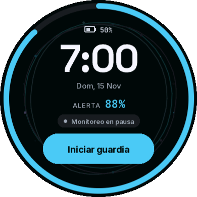 | 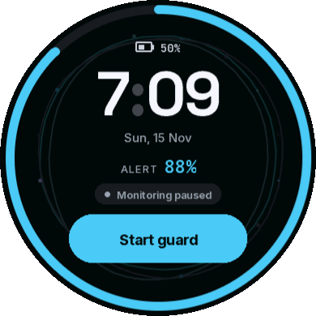 |
| Orbe activo (modo demo) | 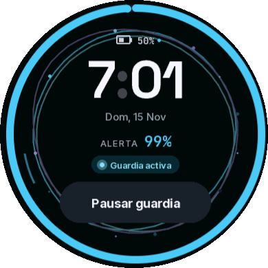 | 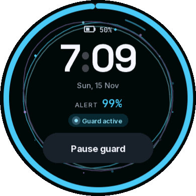 |
| Alerta nivel 1 | 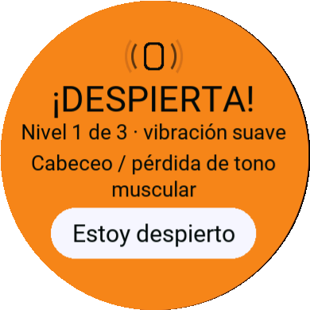 | 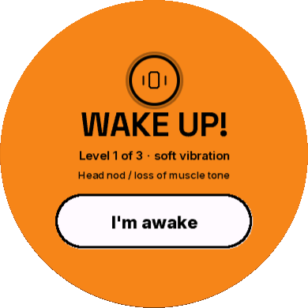 |
| Alerta nivel 2 | 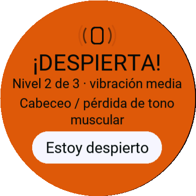 | 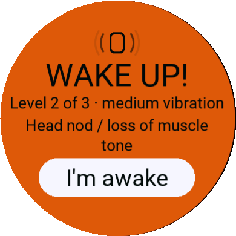 |
| Alerta nivel 3 | 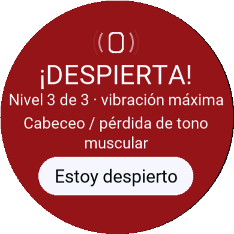 | 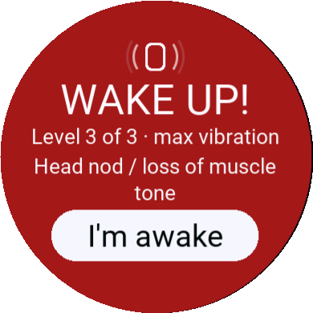 |
| Ajustes | 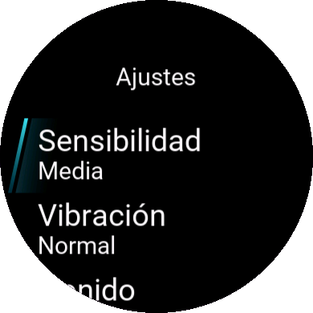 | 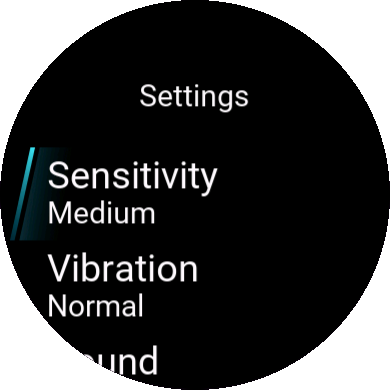 |
| Modelo IA | 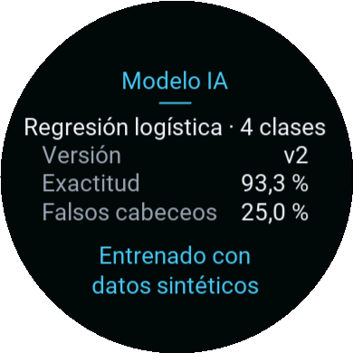 | 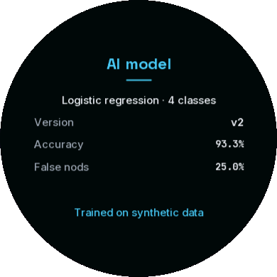 |
| Resumen de la guardia | 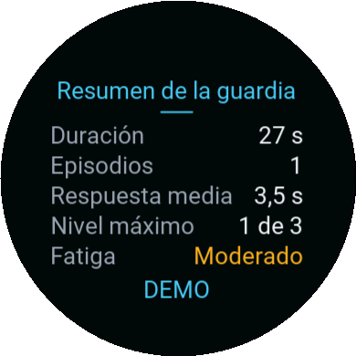 | 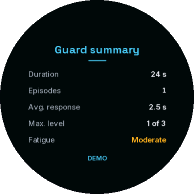 |
| Historial | 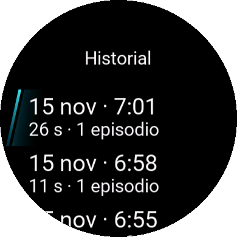 | 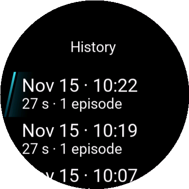 |
| Sin datos del sensor | 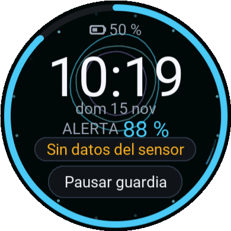 | 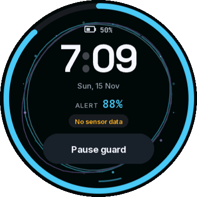 |

Las alertas de nivel 1 a 3 son "Probar alerta" (motivo: cabeceo). La de nivel 3 en inglés
se tomó después de acortar "max vibration". El historial contiene guardias de prueba del
modo demo.
