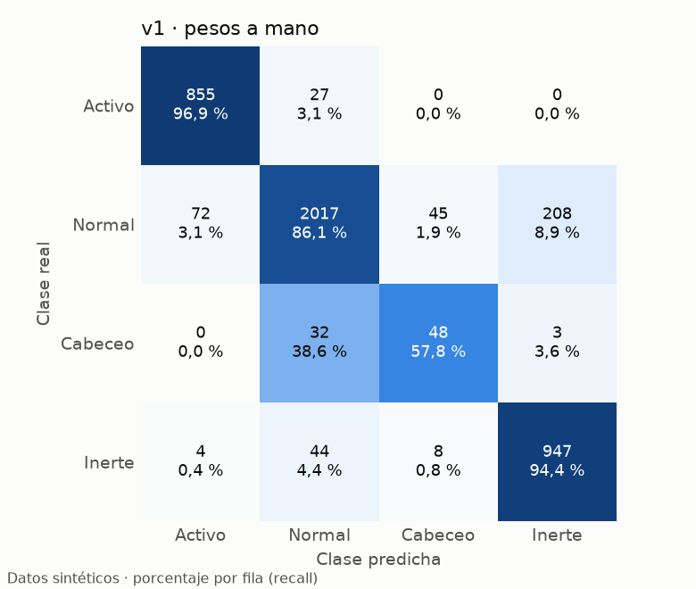
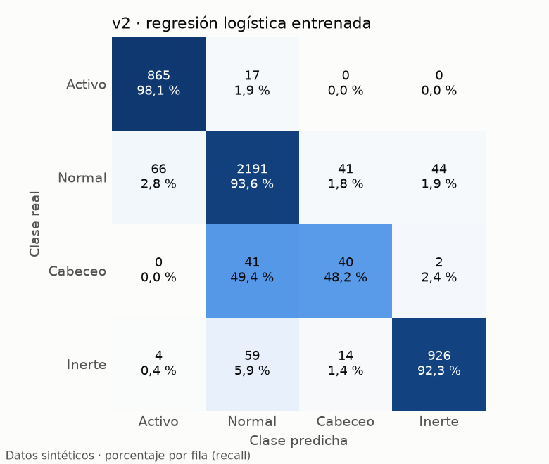
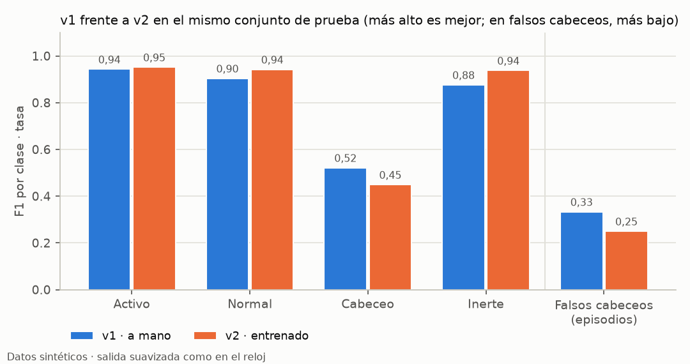

# Informe de entrenamiento — clasificador de estado v2

> **Datos sintéticos.** Todo sale de `ml/generate_dataset.py`, que reproduce las firmas
> del simulador del reloj con variaciones por usuario. Estas cifras dicen si el
> pipeline funciona y comparan v1 con v2 en igualdad de condiciones; **no son precisión
> en muñecas reales**.

Generado por `ml/train.py` el 2026-11-14 (semilla 20261114).

## Dataset y división

- 48 usuarios sintéticos, 528 secuencias, 17376 ventanas de 1 s.
- Prueba: 12 usuarios completos (4310 ventanas), que no
  aparecen en el entrenamiento (13066 ventanas).
- Validación cruzada: GroupKFold(5) por usuario; peso de clase por el criterio (media de F1 de Activo, Normal e Inerte y F0,5 de Cabeceo); C, el menor con el mejor log-loss de ese peso (tolerancia 0.001). Elegido: C = 1,
  class_weight = {2: 2.0} (criterio 0.831, log-loss
  0.216). El criterio pesa más la precisión de Cabeceo
  (F0,5) porque en la app un falso Cabeceo baja el puntaje y la alerta la abre el detector
  por reglas; C se elige por log-loss porque el puntaje usa las probabilidades.
- **Fuga de datos:** con la misma configuración, la exactitud de validación cruzada con
  ventanas sueltas es 93,8 % y agrupada por usuario 93,7 %.

## Resultado (salida suavizada, como en el reloj)

| Métrica | v1 (a mano) | v2 (entrenado) |
|---|---|---|
| Exactitud | 89,7 % | 93,3 % |
| F1 macro | 0.811 | 0.820 |
| Falsos cabeceos, episodios de negativos difíciles | 16 de 48 (33,3 %) | 12 de 48 (25,0 %) |
| Falsos cabeceos, ventanas de negativos difíciles | 3,9 % | 3,6 % |
| Cabeceos al pasar de tecleo a normal (ventanas) | 0 de 365 | 0 de 365 |
| Exactitud sin suavizar | 90,5 % | 93,6 % |

Un *episodio* es una secuencia de negativo difícil (mirar la hora o apoyar el brazo);
cuenta como falso cabeceo si al menos una de sus ventanas sale Cabeceo.

### Por clase — precisión / recall / F1

| Clase | v1 | v2 | Ventanas |
|---|---|---|---|
| Activo | 0.918 / 0.969 / 0.943 | 0.925 / 0.981 / 0.952 | 882 |
| Normal | 0.951 / 0.861 / 0.904 | 0.949 / 0.936 / 0.942 | 2342 |
| Cabeceo | 0.475 / 0.578 / 0.522 | 0.421 / 0.482 / 0.449 | 83 |
| Inerte | 0.818 / 0.944 / 0.876 | 0.953 / 0.923 / 0.938 | 1003 |

### Negativos difíciles por tipo

| Tipo | v1, episodios | v2, episodios | Ventanas v1 → v2 |
|---|---|---|---|
| apoyar_brazo | 0 de 24 (0,0 %) | 0 de 24 (0,0 %) | 0,0 % → 0,0 % |
| mirar_hora | 16 de 24 (66,7 %) | 12 de 24 (50,0 %) | 7,1 % → 6,5 % |

### Matriz de confusión v1

| Real \ Predicha | Activo | Normal | Cabeceo | Inerte | Recall |
|---|---|---|---|---|---|
| **Activo** | **855** | 27 | 0 | 0 | 96,9 % |
| **Normal** | 72 | **2017** | 45 | 208 | 86,1 % |
| **Cabeceo** | 0 | 32 | **48** | 3 | 57,8 % |
| **Inerte** | 4 | 44 | 8 | **947** | 94,4 % |

### Matriz de confusión v2

| Real \ Predicha | Activo | Normal | Cabeceo | Inerte | Recall |
|---|---|---|---|---|---|
| **Activo** | **865** | 17 | 0 | 0 | 98,1 % |
| **Normal** | 66 | **2191** | 41 | 44 | 93,6 % |
| **Cabeceo** | 0 | 41 | **40** | 2 | 48,2 % |
| **Inerte** | 4 | 59 | 14 | **926** | 92,3 % |

## Detector por reglas (referencia)

Quien abre la alerta en la app es `DrowsinessDetector` (sacudida + quietud + inclinación),
no el clasificador; sus eventos son los mismos con v1 y con v2. Secuencias de prueba con
al menos un evento CABECEO:

| Tipo de secuencia | Con evento CABECEO |
|---|---|
| apoyar_brazo | 0 de 24 (0,0 %) |
| cabeceo | 22 de 36 (61,1 %) |
| inactividad | 0 de 12 (0,0 %) |
| mirar_hora | 15 de 24 (62,5 %) |
| mixta | 0 de 24 (0,0 %) |
| tecleo_normal | 0 de 12 (0,0 %) |
